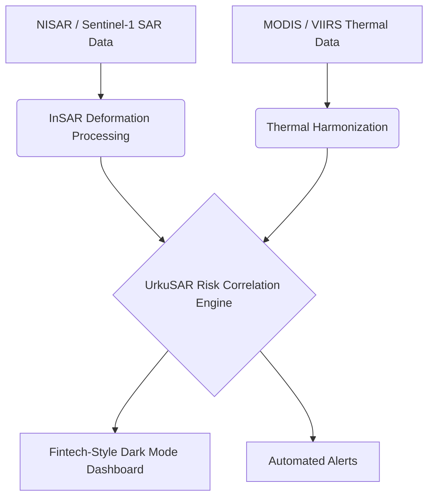

# UrkuSAR 
## NASA Space Apps Challenge 2026 - Challenge: Dancing with the SARs


UrkuSAR (from Urku, meaning mountain in Kichwa, and SAR, Synthetic Aperture Radar) is a hybrid early-warning pipeline that fuses ground deformation data with thermal anomalies to predict geotechnical collapses and volcanic hazards.
By crossing phase-unwrapped InSAR data with harmonized thermal signatures, UrkuSAR translates complex Earth observation metrics into an actionable, high-contrast risk dashboard for civil protection agencies.

### The Problem

Geotechnical failures (like massive landslides post-wildfires) and volcanic eruptions are always preceded by two factors: millimetric ground deformation and thermal anomalies. Currently, this data is siloed. Radar data (SAR) tells us the earth is moving, and thermal data tells us it's heating up, but agencies lack an automated pipeline to cross-reference both datasets in real-time to declare an imminent structural collapse.

### The UrkuSAR Solution

- We built an automated pipeline that ingests Level-2/Level-3 NASA data to evaluate multi-variable risks.
- Radar Deformation (NISAR / Sentinel-1): Tracks millimetric tension and subsidence.
- Thermal Harmonization (MODIS / VIIRS): Tracks abnormal heat fluxes and post-fire vulnerability.
- Risk Correlation Engine: A mathematical model that flags "Critical Red Zones" when thermal instability and physical deformation converge.

### Tech Stack

- Data Ingestion & Processing: Python, Google Earth Engine (GEE) API, NASA Earthdata.
- Machine Learning / Analysis: PyTorch, Pandas, NumPy, SciPy.
- Frontend / Visualization: React, Next.js, Mapbox GL JS, Deck.gl (Designed with a high-contrast, dark-mode/fintech aesthetic for immediate decision-making).

## How it Works (The Pipeline)



## Getting Started
### Prerequisites
* Python 3.10+
* Node.js v18+
* NASA Earthdata Account (for API access)
* Mapbox API Key (for frontend rendering)

### Installation

1. **Clone the repository:**
   ```bash
   git clone https://github.com/your-username/UrkuSAR.git
   cd UrkuSAR
   ```

2. **Backend Setup (Data Pipeline):**
   ```bash
   cd backend
   python -m venv venv
   source venv/bin/activate  # On Windows use `venv\Scripts\activate`
   pip install -r requirements.txt
   ```

3. **Frontend Setup (Dashboard):**
   ```bash
   cd ../frontend
   npm install
   ```

4. **Environment Variables:**
   Create a `.env` file in the root directory and add your keys:
   ```env
   NASA_EARTHDATA_TOKEN=your_token_here
   MAPBOX_ACCESS_TOKEN=your_token_here
   ```

5. **Run the Application:**
   * Backend: `python app.py`
   * Frontend: `npm run dev`

---


## UI/UX Philosophy

UrkuSAR steps away from traditional, cluttered topographic maps. We utilize a minimalist, high-contrast dark mode interface (inspired by fintech platforms). This ensures that decision-makers are not overwhelmed by raw scientific data, but rather presented with clear, glowing neon risk indicators that demand immediate action.

*Built with passion in Manta, Ecuador 🇪🇨 for the NASA Space Apps Challenge 2026.*

Built with passion in Manta, Ecuador 🇪🇨 for the NASA Space Apps Challenge 2026.
